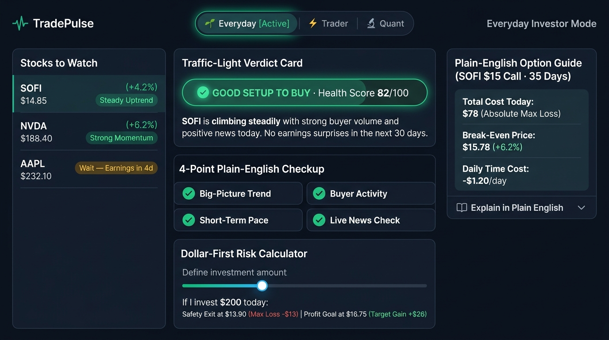
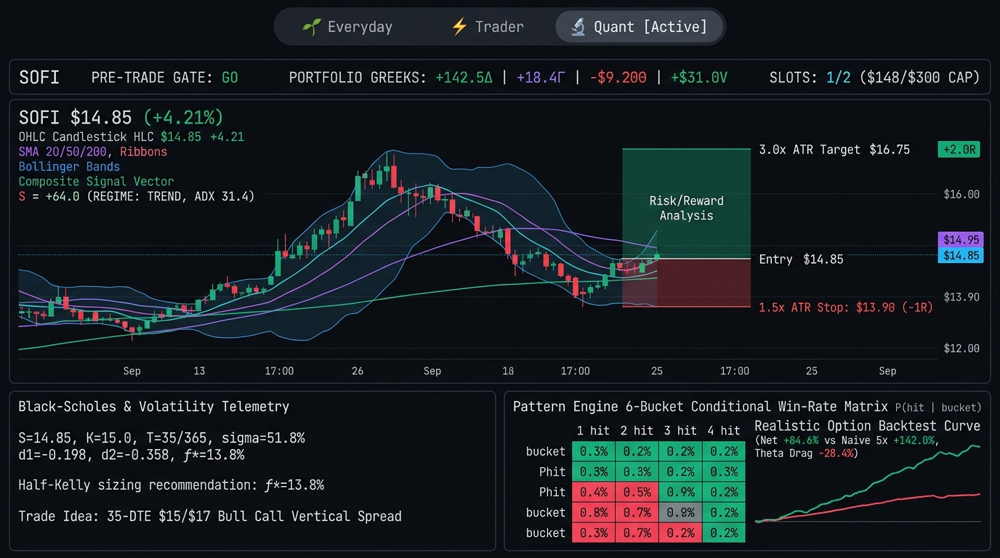
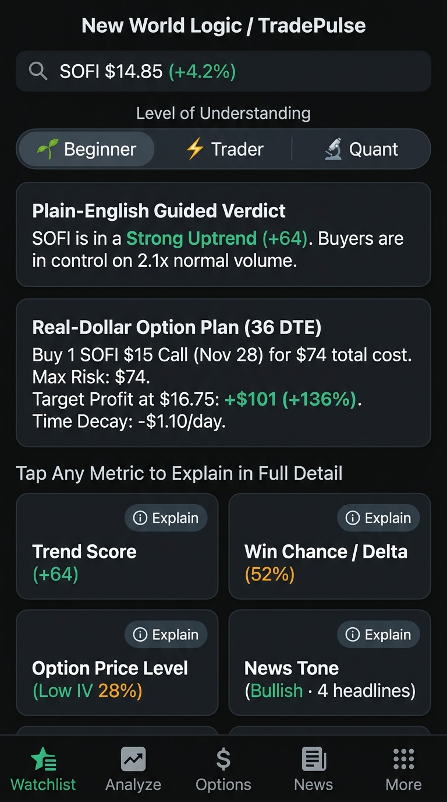
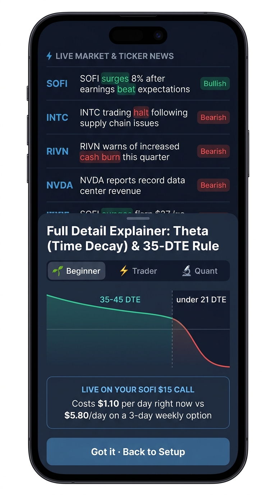
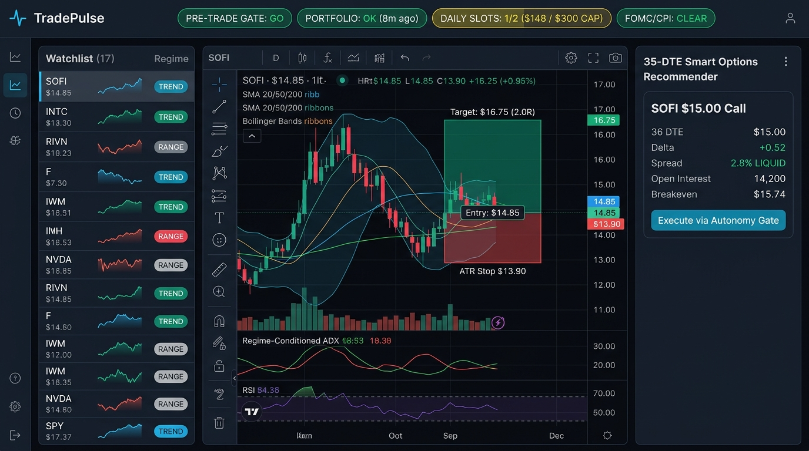
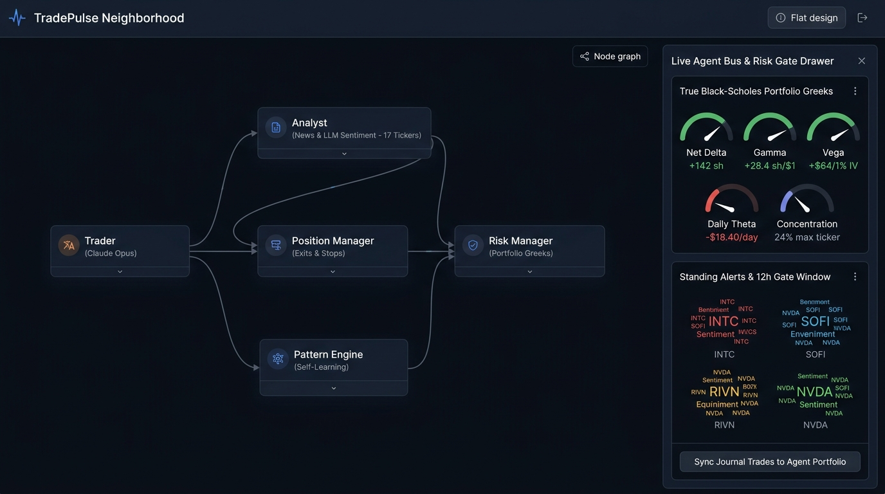
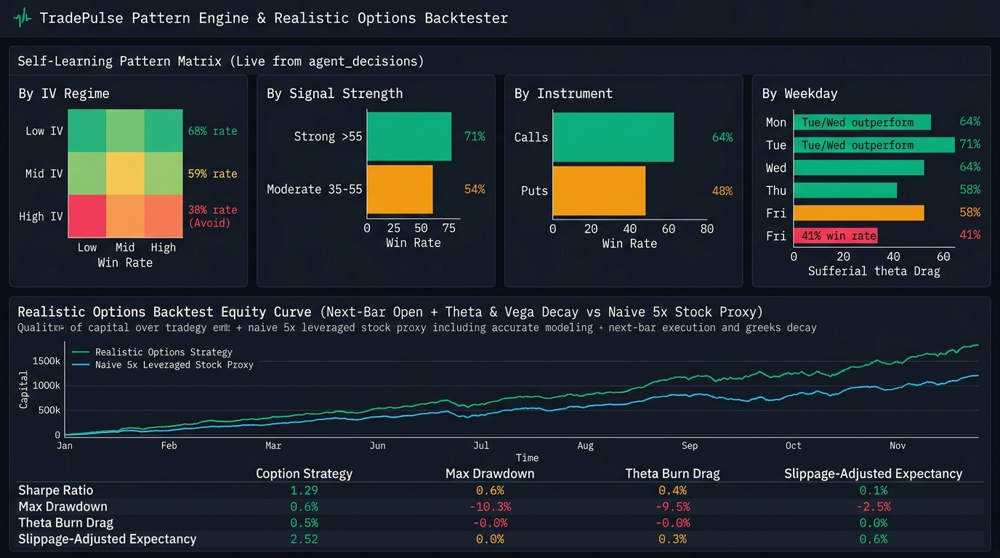
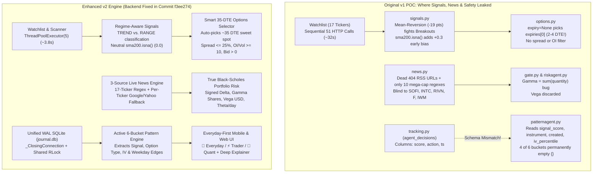

# Trading Platform by New World Logic: The Full Story & v2 Enhancement Blueprint

> [!IMPORTANT]
> **Product North Star — Built for Everyday People, Powered by Institutional Quant Math:**
> **Trading Platform by New World Logic** is designed **first and foremost for everyday people who are not professional traders** — while keeping a real quantitative engine and 5 autonomous safety agents under the hood. Instead of intimidating users with raw Wall Street acronyms (`MACD`, `PCR (OI)`, `IV Skew`, `0.35Δ`, `ATR`), the default **🌱 Everyday Mode** translates every screen into **Plain-English Traffic-Light Verdicts, Dollar-First Risk/Reward (`$100–$300` budget), Plain-English Option Tickets, and Interactive Deep-Dive Explainers**. Technical users who want full mathematical transparency can switch to **⚡ Trader** or **🔬 Quant** mode at any time.
>
> **Interactive Prototype Available:** Open [`interactive_story_prototype.html`](file:///Users/aavernon2/Documents/Github/trade/docs/v2-blueprint/interactive_story_prototype.html) in any browser to interactively toggle between **v1 (Broken POC)**, **v2 Pro Engine**, and the **🌱 Everyday Person vs. ⚡ Trader vs. 🔬 Quant** views across all 5 chapters.

---

## Visual Mockup Gallery (Everyday Investor Mode vs. Technical & Quant Mode + Mobile)

### 1. 🌱 Everyday Investor Mode (Default)


### 2. 🔬 Technical & Quant Mode


### 3. Mobile-First 3-Level Adaptive UI (`🌱 Everyday` · `⚡ Trader` · `🔬 Quant`)


### 4. Mobile Deep-Dive Plain-English Explainer & 17-Ticker Live News Feed


### 5. Desktop Command Center & 35-DTE Liquidity-Filtered Options


### 6. 5-Agent Neighborhood & True Black-Scholes Portfolio Greeks


### 7. Self-Learning Pattern Matrix & Realistic Options Backtester


---

## Chapter 0: Designing for Everyday People (Non-Professional Traders)

### Why Most Trading Apps Fail Everyday People
Most retail apps either gamify trading into reckless confetti (encouraging users to buy 2-day expiring options that lose 90% to time decay) or dump a Bloomberg-style wall of numbers (`RSI 71.4`, `Stoch %K/%D`, `IV Rank 64%`, `Delta 0.35`, `Theta -0.14`) that requires a finance degree to interpret.

### The 4 Plain-English Questions Every Screen Must Answer
In **🌱 Everyday Mode (Default)**, every screen in TradePulse v2 is organized around four human questions:

1. **"What's happening with this stock right now, and why?"**
   - Replaces raw indicator tables with a **4-Point Plain-English Health Check**:
     - ✅ **Long-Term Trend:** Moving steadily upward over the last 3 months.
     - ✅ **Buyer Volume:** More money is flowing in than flowing out this week.
     - ⚠️ **Short-Term Stretch:** Price jumped fast over the last 5 days — could take a breather.
     - 📰 **Why It's Moving (Live News):** 3 positive headlines today; 0 negative alerts.
2. **"Is today a good time to buy, wait, or stay away?"**
   - **Traffic-Light Action Banner ("The Bottom Line"):**
     - 🟢 **Good Setup to Buy** | 🟡 **Wait for a Better Price** | 🔴 **High Risk — Stay Away**
     - Accompanied by a 2-sentence plain-English coach summary explaining *why* and what could go wrong.
3. **"If I put in \$100–\$300, what can I make and what can I lose?"**
   - **Dollar-First Risk Calculator** (instead of `1.5x ATR Stop` or `2.0R Target`):
     - User picks their dollar budget (e.g. **\$200**):
     - 🛡️ **Safety Exit (Stop-Loss):** If the stock drops to **\$13.90**, exit to cap your loss at **-\$13**.
     - 🎯 **Profit Goal:** If the stock reaches **\$16.75**, take profit for a **+\$26** gain.
4. **"If I buy an option, what does the contract actually mean in dollars and days?"**
   - Replaces the intimidating 40-row Calls/Puts spreadsheet with a single **Plain-English Option Ticket** (keeping the raw strike table tucked inside an optional *"Show Advanced Options Table"* drawer):
     - **Total Upfront Cost:** **\$78** *(This is the absolute maximum you can lose)*
     - **Break-Even Price:** Stock must rise above **\$15.78** (+6.2%) before **Nov 27 (35 days)**
     - **Daily Time Decay Cost:** Costs about **\$1.20/day** while you wait
     - **Safety Guardrails:** ✅ *35 days gives plenty of time* · ✅ *No earnings report before expiration* · ✅ *Fits inside your \$300 cap*

### The 3-Tier Level of Understanding Engine
| Feature / Screen | 🌱 Everyday Mode (Default) | ⚡ Trader Mode | 🔬 Quant Mode |
| :--- | :--- | :--- | :--- |
| **Navigation Labels** | *Stock Checkup, Today's Ideas, Safety Check, Options Guide, Track Record, AI Coach* | *Chart, Scanner, Scorecard, Options, Backtest, Agent* | *Technicals, Multi-Factor Scan, Confluence, Chain & Greeks, Sim, Bus* |
| **Signal Summary** | Traffic-Light Verdict + 4-Point Plain-English Checklist | Composite Score (`-100..+100`) + 7 Indicator Vote Bars + ATR Targets | Normalized Weight Vector $w_i \cdot d_i$, Regime State (`TREND`/`RANGE`), Raw Indicator Values |
| **Risk & Sizing** | Dollar Slider (\$100–\$300) showing exact `-\$Loss` and `+\$Gain` | Entry, `1.5×ATR` Stop, `3.0×ATR` Target (2.0R) | Kelly Criterion $f^*$, Volatility-Adjusted Sizing, Portfolio Beta/Delta Impact |
| **Options Tab** | Plain-English Option Ticket (Cost, Break-Even Date, Daily Time Cost, Safety Checks) | Recommended `0.35Δ` Call/Put + Bull/Bear Vertical Spread + Chain | Black-Scholes $d_1, d_2$, IV Percentile vs. 30d Realized Vol, Net $\Delta, \Gamma, \Theta, \mathcal{V}$ |
| **Interactive Explainer** | *"What is this?"* + Real-World Analogy + *"What should I do?"* | *"How traders use this"* + Entry/Exit rules + Common traps | Exact Mathematical Formula + Parameter Sensitivity + Failure Modes |

---

## End-to-End Architecture Story: v1 Bugs vs. Enhanced v2 Engine



---

## Chapter 1: Stock Checkup, Regime-Aware Signals & Safe 35-DTE Options

### What Was Broken in v1 (Fixed in POC Commit `f3ee274`)
1. **Early-History Bullish Bias ([`app/signals.py`](file:///Users/aavernon2/Documents/Github/trade/app/signals.py#L61-L76)):** When `sma200` was `NaN` during the first 200 trading bars, `pd.isna(row["sma200"])` evaluated to `True`, awarding an automatic `+0.3` bullish trend vote on every bar.
2. **The Front-Week Expiry Trap ([`app/options.py`](file:///Users/aavernon2/Documents/Github/trade/app/options.py#L131-L154)):** Calling `analyze_chain(ticker, expiry=None)` defaulted to `expiries[0]` (often **1 to 4 DTE**), recommending a weekly lottery ticket that burned 25%+ of its value per day in theta decay.
3. **51 Sequential Yahoo Finance Requests ([`app/scanner.py`](file:///Users/aavernon2/Documents/Github/trade/app/scanner.py#L63-L75), [`app/main.py`](file:///Users/aavernon2/Documents/Github/trade/app/main.py#L86-L125)):** Scanning the 17-ticker watchlist ran sequentially in a single thread (~32 seconds on a cold cache).

### How It Works Now & In the v2 Standalone Repo
* **Neutral Warm-Up + `TREND`/`RANGE` Regime Tagging ([`app/signals.py`](file:///Users/aavernon2/Documents/Github/trade/app/signals.py#L61-L185)):** Missing `sma200` now contributes `0.0` in both `score_frame()` and `score_series()`, and every scored ticker exposes `"regime": "TREND" | "RANGE"`.
* **Automatic ~35 DTE Selection & Liquidity Filter ([`app/options.py`](file:///Users/aavernon2/Documents/Github/trade/app/options.py#L131-L320)):** [`_pick_target_expiry()`](file:///Users/aavernon2/Documents/Github/trade/app/options.py#L131-L142) chooses the expiration closest to **35 DTE** within the 21–60 DTE window, and [`_recommend()`](file:///Users/aavernon2/Documents/Github/trade/app/options.py#L234-L320) filters for liquid strikes (`bid > 0`, spread $\le 25\%$, and OI or volume $\ge 10$).
* **Everyday Plain-English Option Ticket (v2 UI):** Translates the recommended 35-DTE contract into total dollar cost, exact break-even stock price, daily time decay in dollars, and a 3-point safety badge.

---

## Chapter 2: The 5 AI Helpers, 17-Ticker Live News Engine & True Portfolio Greeks

### What Was Broken in v1 (Fixed in POC Commit `f3ee274`)
1. **Dead 404 RSS Feeds & Missing Watchlist Tickers ([`app/news.py`](file:///Users/aavernon2/Documents/Github/trade/app/news.py#L30-L120)):** Two of the four RSS feeds (`Yahoo Finance rssindex` and `Seeking Alpha combined/technology.xml`) returned HTTP 404, and `TICKER_PATTERNS` only matched 10 mega-caps — completely blind to `INTC`, `SOFI`, `F`, `RIVN`, `SPY`, `QQQ`, and `IWM`.
2. **Contract Count Mistaken for Gamma ([`app/riskagent.py`](file:///Users/aavernon2/Documents/Github/trade/app/riskagent.py#L112-L135)):** `riskagent.py` summed raw unsigned `quantity` as `total_gamma` and discarded `vega` altogether.

### How It Works Now & In the v2 Standalone Repo
* **3-Tier Live News Engine ([`app/news.py`](file:///Users/aavernon2/Documents/Github/trade/app/news.py#L285-L380)):**
  1. Live market RSS feeds (`CNBC Top News`, `MarketWatch Top Stories`, `Seeking Alpha Market Currents`, `Nasdaq Markets`, `Google Finance News`) with a zero-dependency `urllib` + `ElementTree` fallback when `feedparser` isn't installed.
  2. Full word-boundary regexes for all **17 watchlist tickers** plus `sentiment_words` extraction so users see *which words* (`beat`, `surge`, `downgrade`, `lawsuit`) drove the sentiment score.
  3. Per-ticker 3-tier fallback in [`get_ticker_news()`](file:///Users/aavernon2/Documents/Github/trade/app/news.py#L325-L380) (Yahoo `Ticker.news` $\to$ Google Finance per-ticker RSS $\to$ Market feed cache) so clicking any ticker always returns relevant headlines.
* **True Signed Black-Scholes Portfolio Greeks ([`app/portfolio.py`](file:///Users/aavernon2/Documents/Github/trade/app/portfolio.py#L253-L315), [`app/positions.py`](file:///Users/aavernon2/Documents/Github/trade/app/positions.py#L37-L100), [`app/riskagent.py`](file:///Users/aavernon2/Documents/Github/trade/app/riskagent.py#L112-L185)):** Rolls up signed `delta_shares`, `gamma_shares`, `theta_per_day`, and `vega_usd` across all open stock and option legs.

---

## Chapter 3: The Self-Learning Pattern Finder (`patternagent.py`)

### What Was Broken in v1 (Fixed in POC Commit `f3ee274`)
[`app/patternagent.py`](file:///Users/aavernon2/Documents/Github/trade/app/patternagent.py#L47-L165) queried `SELECT * FROM agent_decisions WHERE hit IS NOT NULL`, where the actual columns are `score`, `action`, `ts`, and `signal` (JSON). Because `analyze_patterns()` looked only for `signal_score`, `instrument`, `created`, and `iv_percentile`, **4 of the 6 learning buckets were permanently empty `{}`**.

### How It Works Now & In the v2 Standalone Repo
* **Dual-Schema Bridge ([`app/patternagent.py`](file:///Users/aavernon2/Documents/Github/trade/app/patternagent.py#L33-L165)):** Automatically reads `score` (or `signal_score`), derives option type from `action` (`call`/`put`/`buy`/`sell`) or `instrument`, parses ISO timestamps with trailing `Z` from `ts`/`created_at`, and extracts `iv_percentile` from the `signal` JSON snapshot (normalizing `0..100` to `0..1`).
* **Everyday Translation in v2 UI:** Displays discovered edges in plain English — e.g., *"Your best setups on NVDA happen when options are cheap (Low IV) and the signal score is Strong (75% win rate across 12 past calls)."*

---

## Chapter 4: Honest Past Track Record (`backtest.py`) & Zero-Leak SQLite WAL

### What Was Broken in v1 (Fixed in POC Commit `f3ee274`)
1. **Unrealistic 5x Option Proxy ([`app/backtest.py`](file:///Users/aavernon2/Documents/Github/trade/app/backtest.py#L130-L173)):** Multiplying stock returns by `5.0x` ignored daily time decay (`Theta`) and bid-ask spread slippage, wildly overstating historical option returns.
2. **SQLite Unclosed Connection Warnings ([`app/tracking.py`](file:///Users/aavernon2/Documents/Github/trade/app/tracking.py#L94-L120), [`app/journal.py`](file:///Users/aavernon2/Documents/Github/trade/app/journal.py#L17-L90), [`onlymeyou/store.py`](file:///Users/aavernon2/Documents/Github/trade/onlymeyou/store.py#L112-L125)):** `with _conn() as c:` in Python's `sqlite3` commits/rolls back the transaction on exit but **never closes the file descriptor**, producing hundreds of `ResourceWarning: unclosed database` warnings.

### How It Works Now & In the v2 Standalone Repo
* **Theta- & Slippage-Adjusted Option Proxy ([`app/backtest.py`](file:///Users/aavernon2/Documents/Github/trade/app/backtest.py#L130-L173)):** Models a ~35-DTE, `0.35Δ` contract with gamma convexity minus `~1.1%/bar` theta decay and `1.5%` round-trip spread slippage, and explicitly reports `naive_5x_return_pct` vs. `option_proxy_return_pct` and `theta_drag_pct`.
* **`_ClosingConnection` + WAL Mode + Shared `RLock`:** All SQLite connections close deterministically on context exit, `PRAGMA journal_mode=WAL` and `PRAGMA busy_timeout=5000` are enabled, and all **362 unit tests** run with zero `ResourceWarning`s.

---

## Chapter 5: Recommended Architecture for the Separate `nwl-trading-platform` Repo

Since this repository served as the v1 POC (and also contains the unrelated `onlymeyou/` app), spinning up a clean **`nwl-trading-platform`** repository for **Trading Platform by New World Logic** lets you pair your proven Python quant/agent backend with a purpose-built, everyday-friendly mobile/web frontend:

```
nwl-trading-platform/
├── backend/                     # FastAPI + Python 3.12+ (Copied directly from fixed POC app/)
│   ├── core/
│   │   ├── signals.py           # Fixed sma200 + TREND/RANGE regime engine
│   │   ├── options.py           # Fixed 35-DTE selector + liquidity filter + Black-Scholes
│   │   ├── backtest.py          # Fixed theta-decay & slippage option simulator
│   │   ├── news.py              # Fixed 3-tier RSS + 17-ticker regex + sentiment words
│   │   └── portfolio.py         # Fixed signed Delta, Gamma, Theta, Vega rollup
│   ├── agents/
│   │   ├── gate.py              # Pre-Trade Gate (GO / STAND DOWN)
│   │   ├── autonomy.py          # $300 cap & 2 daily slot enforcer
│   │   ├── newsagent.py         # Agent #1: News & Macro Reader
│   │   ├── positionagent.py     # Agent #2: Open Position Watcher
│   │   ├── riskagent.py         # Agent #3: Portfolio Risk Guard
│   │   ├── patternagent.py      # Agent #5: Self-Learning Pattern Finder
│   │   └── tracking.py          # WAL SQLite bus + _ClosingConnection
│   └── api/
│       └── main.py              # REST + WebSocket live stream + Everyday Coach translator
│
└── frontend/                    # Next.js (App Router) + Tailwind + Lightweight Charts (or Expo)
    ├── src/
    │   ├── context/
    │   │   └── LearningModeContext.tsx   # 🌱 Everyday (Default) | ⚡ Trader | 🔬 Quant
    │   ├── components/
    │   │   ├── everyday/
    │   │   │   ├── TrafficLightVerdict.tsx    # Green/Yellow/Red plain-English action card
    │   │   │   ├── FourPointCheckup.tsx       # Trend, Volume, Stretch, News checklist
    │   │   │   ├── DollarRiskSlider.tsx       # "$100-$300 invested -> -$Loss / +$Gain"
    │   │   │   └── PlainEnglishOptionCard.tsx # Max dollar loss, break-even date, daily time cost
    │   │   ├── explainer/
    │   │   │   └── DeepDiveSheet.tsx          # Bottom-sheet explainer with analogies & formulas
    │   │   ├── charts/
    │   │   │   └── RiskRewardChart.tsx        # Candlestick/Area chart with visual Stop & Target zones
    │   │   └── layout/
    │   │       ├── SafetyBanner.tsx           # Friendly top status bar (Market Calm / Earnings Alert)
    │   │       └── MobileBottomNav.tsx        # Native-feel 5-tab thumb navigation
```
